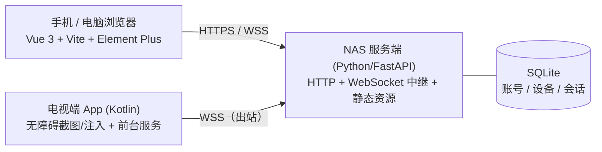
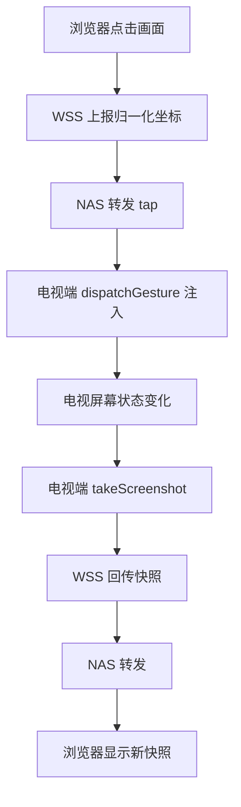
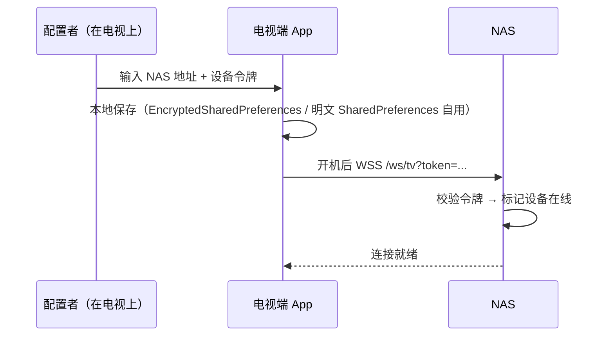
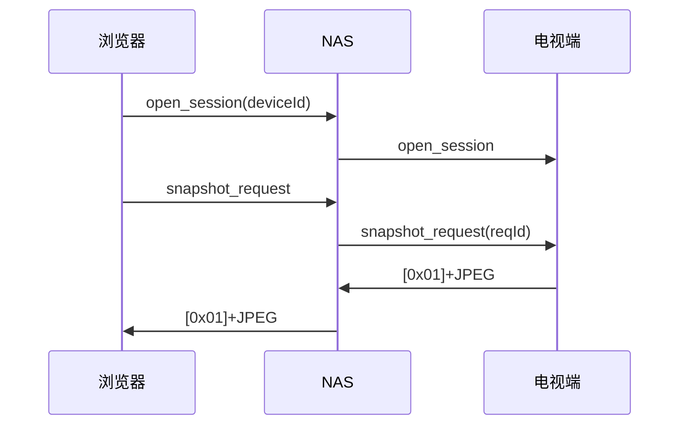
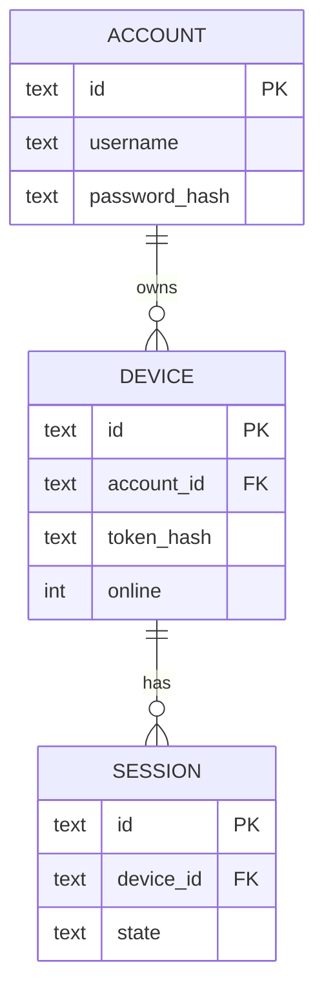
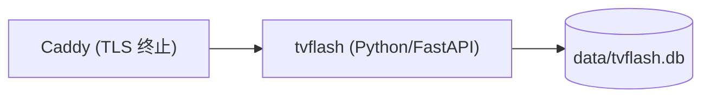

# TV Flash 技术方案（异地电视远程协助）

| 项目 | 内容 |
|------|------|
| 文档版本 | v1.0（初稿） |
| 创建日期 | 2026-11-16 |
| 文档状态 | 草稿（待评审） |
| 目标读者 | 后端开发、前端开发、Android 开发、测试 |

## 文档定位

本文档描述「TV Flash」的整体技术方案：帮助者通过**浏览器**访问自建 **NAS**，在登录后遥控被协助者的 **Android 电视**（查看屏幕快照、点按注入）。范围覆盖 Web 前端、NAS 后端、电视端 App 三端及其通信协议、数据模型、认证与部署。

---

## 一、背景与需求

### 1.1 需求背景

| 项目 | 说明 |
|------|------|
| 业务场景 | 异地帮家人（如父母）操作电视：自己不在电视旁，用手机/电脑遥控 |
| 痛点问题 | 电话口述步骤低效；市面远程协助工具需双方装 App、操作复杂 |
| 目标价值 | 帮助者只需打开浏览器、登录 NAS，就能看画面、点按电视；电视端一次配置后自动在线 |

### 1.2 方案要点（已确认的关键决策）

| # | 决策 | 说明 |
|---|------|------|
| 1 | 手机端不做 App | 改为 **NAS 托管 Web 页面**，浏览器访问 |
| 2 | 不做实时镜像 | 按需 + 低频**快照**（见 ADR-0001） |
| 3 | 全经 NAS 中继 | 两端出站连 NAS，不做 P2P（见 ADR-0002） |
| 4 | 无障碍服务为基础 | `takeScreenshot` + `dispatchGesture`（见 ADR-0003） |
| 5 | 认证方式 | 浏览器**账号密码登录**；电视端**设备令牌**首次配置；**无配对码** |
| 6 | 账号体系 | **单账号 / 家庭** |
| 7 | 坐标 | **归一化相对坐标（0~1）**，电视端按自身分辨率换算 |
| 8 | 真机验证 | 视为默认可行（不再阻塞方案） |

---

## 二、系统架构

### 2.1 架构图



### 2.2 组件说明

| 组件 | 角色 | 职责 |
|------|------|------|
| Web 前端（浏览器） | 帮助端 | 登录、电视列表、会话、显示快照、发送点按/滑动/系统键 |
| NAS 服务端（Python / FastAPI） | 中枢 | 登录认证、设备令牌校验、WebSocket 双向中继、快照/指令转发、会话管理、静态资源托管 |
| SQLite | 存储 | 账号、电视设备、会话记录 |
| 电视端 App（Kotlin） | 被协助端 | 首次配置并常驻连 NAS；无障碍截图、注入点击、系统键 |

### 2.3 数据流



---

## 三、功能矩阵（按实现拆分）

| 模块 | 子功能 | 端 | 优先级 | 复杂度 |
|------|--------|----|--------|--------|
| 认证 | 账号密码登录 / 登出 | Web + NAS | P0 | 低 |
| 设备 | 电视首次配置（NAS 地址 + 令牌） | 电视端 | P0 | 中 |
| 设备 | 设备注册、在线/离线状态 | NAS | P0 | 中 |
| 设备 | 设备列表查询 | Web + NAS | P0 | 低 |
| 会话 | 打开 / 关闭会话 | Web + NAS + 电视端 | P0 | 中 |
| 快照 | 请求并显示快照 | 三端 | P0 | 中 |
| 遥控 | 点按（归一化坐标） | 三端 | P0 | 中 |
| 遥控 | 滑动 | 三端 | P1 | 中 |
| 遥控 | 系统键（返回/主页/音量） | 三端 | P1 | 低 |
| 管理 | 断开连接、设备拉黑 | Web + NAS + 电视端 | P1 | 中 |
| 通信 | 心跳 / 断线重连 | 三端 | P0 | 中 |

---

## 四、通信协议

### 4.1 连接模型

| 通道 | 端点 | 认证方式 |
|------|------|---------|
| Web HTTP | `POST /api/login` | 账号 + 密码 |
| Web 业务 | `/api/*`（REST） | session cookie |
| 浏览器实时 | `WS /ws/web` | session cookie |
| 电视端实时 | `WS /ws/tv` | `?token=<设备令牌>` |

### 4.2 帧格式

- **文本帧**：JSON 控制消息（带 `type` 字段）；
- **二进制帧**：图片（首字节 `0x01` = 快照，其后为 JPEG 字节流）。用二进制避免 base64 膨胀。

### 4.3 消息定义

**浏览器 → NAS**

| type | 字段 | 说明 |
|------|------|------|
| `open_session` | `deviceId` | 打开对某设备的会话 |
| `close_session` | `deviceId` | 关闭会话 |
| `snapshot_request` | `deviceId` | 请求一张快照 |
| `tap` | `deviceId, x, y` | 归一化坐标点按（0~1） |
| `swipe` | `deviceId, x1, y1, x2, y2, durationMs` | 滑动 |
| `system_key` | `deviceId, key`（`back`/`home`/`vol_up`/`vol_down`） | 系统键 |

**NAS → 电视端**

| type | 字段 | 说明 |
|------|------|------|
| `open_session` / `close_session` | — | 会话控制 |
| `snapshot_request` | `reqId` | 请求快照 |
| `tap` | `x, y` | 归一化坐标 |
| `swipe` | `x1, y1, x2, y2, durationMs` | 滑动 |
| `system_key` | `key` | 系统键 |

**电视端 → NAS**

| 帧 | 说明 |
|----|------|
| 文本 `device_hello` | 建立连接后上报 `name`、能力位 |
| 二进制 `0x01 + JPEG` | 一张快照 |
| 文本 `ack` | 指令回执（`reqId`） |

**NAS → 浏览器**

| type | 字段 | 说明 |
|------|------|------|
| `device_list` | `devices[]` | 设备及其在线状态 |
| `device_status` | `deviceId, online` | 状态变化推送 |
| `session_state` | `deviceId, state` | 会话状态 |
| 二进制 `0x01 + JPEG` | `snapshot_request` 的响应快照 |  |

### 4.4 示例

浏览器点按：

```json
{ "type": "tap", "deviceId": "d_8f3a", "x": 0.42, "y": 0.61 }
```

电视端上报快照（二进制帧）：`[0x01][JPEG bytes...]`

---

## 五、功能详细设计

### 5.1 登录认证

| 项目 | 说明 |
|------|------|
| 触发 | 浏览器访问 NAS，未登录 |
| 流程 | 输入账号密码 → NAS 校验（密码 bcrypt/argon2）→ 下发 `HttpOnly; Secure` session cookie |
| 失败 | 返回统一错误，限流（同 IP 5 次/分钟） |

### 5.2 电视端首次配置与接入



- 设备令牌在 NAS 端生成（Web 管理页或 CLI），以 **哈希**入库；
- 电视端只保存令牌明文（自用可接受；生产建议加密存储）；
- 令牌可重置/吊销（拉黑即吊销）。

### 5.3 会话与快照



- 电视端收到 `snapshot_request` 后调用 `takeScreenshot`，压缩 JPEG（质量 60~80），回传；
- 浏览器把图片画到 ``/canvas，点按时把点击位置换算为归一化坐标发送 `tap`。

### 5.4 遥控注入（电视端）

| 动作 | 实现 |
|------|------|
| 点按 | `dispatchGesture`，`Path.moveTo(x*W, y*H)`，时长 60~100ms |
| 滑动 | `dispatchGesture`，`Path.moveTo` + `lineTo`，指定 duration |
| 系统键 | `performGlobalAction`（返回 `GLOBAL_ACTION_BACK`、主页 `GLOBAL_ACTION_HOME`）；音量用 `AudioManager` |

> W/H 为电视端 `wm size` 的物理分辨率；归一化坐标在此换算。

### 5.5 断开与拉黑

- 浏览器可 `close_session`；
- Web 管理可"拉黑"设备 → NAS 吊销令牌并断开其 WS；
- 电视端可一键断开当前会话、清空本地配置。

---

## 六、数据库设计（SQLite）

### 6.1 规范

| 规范项 | 要求 |
|--------|------|
| 主键 | `id` TEXT，存 UUID/雪花字符串，禁止自增 |
| 逻辑删除 | `deleted`，1-正常，2-删除 |
| 乐观锁 | `version`，更新校验 |
| 外键 | 不用数据库外键，代码维护 |
| 时间 | 存 UTC，`INTEGER`（毫秒时间戳）或 TEXT ISO8601 |
| 索引 | `idx_表_字段`（普通）、`uk_表_字段`（唯一） |

### 6.2 表结构

**sys_account（账号）**

| 字段 | 类型 | 必填 | 默认 | 注释 |
|------|------|------|------|------|
| id | TEXT | 是 | | 主键 |
| username | TEXT | 是 | | 登录名（唯一） |
| password_hash | TEXT | 是 | | bcrypt/argon2 哈希 |
| state | TEXT | 否 | enabled | 状态 |
| version | INTEGER | 否 | 0 | 乐观锁 |
| deleted | INTEGER | 否 | 1 | 1-正常 2-删除 |
| create_time | INTEGER | 否 | | 创建时间 |
| update_time | INTEGER | 否 | | 更新时间 |

索引：`uk_sys_account_username`(username)

**biz_device（电视设备）**

| 字段 | 类型 | 必填 | 默认 | 注释 |
|------|------|------|------|------|
| id | TEXT | 是 | | 主键 |
| account_id | TEXT | 是 | | 归属账号 |
| name | TEXT | 否 | | 设备名（如"客厅电视"） |
| token_hash | TEXT | 是 | | 设备令牌哈希 |
| online | INTEGER | 否 | 0 | 0 离线 1 在线 |
| last_seen | INTEGER | 否 | | 最后在线时间 |
| version | INTEGER | 否 | 0 | 乐观锁 |
| deleted | INTEGER | 否 | 1 | 逻辑删除 |
| create_time | INTEGER | 否 | | |
| update_time | INTEGER | 否 | | |

索引：`uk_biz_device_token`(token_hash)、`idx_biz_device_account`(account_id)

**biz_session（会话记录）**

| 字段 | 类型 | 必填 | 默认 | 注释 |
|------|------|------|------|------|
| id | TEXT | 是 | | 主键 |
| device_id | TEXT | 是 | | 设备 |
| state | TEXT | 否 | active | active/closed |
| started_at | INTEGER | 否 | | 开始时间 |
| ended_at | INTEGER | 否 | | 结束时间 |
| version | INTEGER | 否 | 0 | |
| deleted | INTEGER | 否 | 1 | |
| create_time | INTEGER | 否 | | |
| update_time | INTEGER | 否 | | |

索引：`idx_biz_session_device`(device_id)

### 6.3 表关系



---

## 七、接口定义

### 7.1 REST

| 方法 | 路径 | 说明 | 鉴权 |
|------|------|------|------|
| POST | `/api/login` | 登录，返回 session cookie | 无 |
| POST | `/api/logout` | 登出 | cookie |
| GET | `/api/devices` | 设备列表及在线状态 | cookie |
| POST | `/api/devices/{id}/kick` | 断开/拉黑设备 | cookie |

登录请求/响应：

```json
// POST /api/login
{ "username": "admin", "password": "******" }
// 200
{ "ok": true }
```

### 7.2 WebSocket

- `GET /ws/web`（浏览器，cookie 鉴权）
- `GET /ws/tv?token=<token>`（电视端，令牌鉴权）

---

## 八、安全设计

| 项 | 方案 |
|----|------|
| 传输加密 | HTTPS/WSS（反向代理 Caddy 自动证书，或自签 + 信任） |
| 密码 | bcrypt/argon2 哈希，禁止明文 |
| 会话 | session cookie：`HttpOnly`、`Secure`、`SameSite=Lax` |
| 设备令牌 | 随机 32 字节，仅存哈希 |
| 限流 | 登录接口按 IP 限流 |
| 暴露面 | 自用建议仅在内网/ZeroTier/Tailscale 访问，不裸奔公网 |
| 审计 | 记录登录、会话开始/结束 |

---

## 九、部署（NAS / Docker）

```text
/docker/tvflash/
├── docker-compose.yml
├── data/
│   └── tvflash.db        # SQLite 卷
├── config.yaml           # 端口、账号初始化、TLS
└── web/ (构建产物 dist)   # 或内嵌进 Go 二进制 (go:embed)
```



- Python 服务（FastAPI + uvicorn）；Web 构建产物作为静态目录由 FastAPI 托管；一个容器即可；
- 首次启动：初始化单账号（配置或首次访问设置密码）；
- 电视端 App 侧载 APK 到电视。

---

## 十、风险与注意点

| 类型 | 描述 | 应对 |
|------|------|------|
| ⚠️ 风险 | 国产电视无障碍可能受限 | 真机验证（默认可行，仍需实测） |
| ⚠️ 风险 | 后台服务被杀 | 前台服务 + 电池/自启白名单 |
| ⚠️ 风险 | 4K vs 1080p 坐标偏差 | 强制归一化坐标换算 |
| 💡 注意 | 浏览器长连接断线 | 心跳 + 自动重连 |
| 💡 注意 | 快照流量 | JPEG 压缩 + 按需请求，不做轮询风暴 |
| 🔧 难点 | WebSocket 双向中继与多路复用 | 按 `deviceId` 路由，浏览器/电视各维护连接表 |
| 🔧 难点 | 设备令牌安全 | 仅存哈希，可吊销 |

---

## 十一、后续待办

1. 生成可编辑 `.drawio` 源图（架构图、连接时序、ER 图）→ `docs/design/diagrams/`；
2. 电视端骨架补"首次配置 + 设备令牌 + WS 客户端"；
3. NAS 服务端（Go）实现认证 + 中继 + SQLite；
4. Web 前端（Vue3 + Element Plus）实现登录 / 设备列表 / 遥控页；
5. Docker 化与部署文档。
