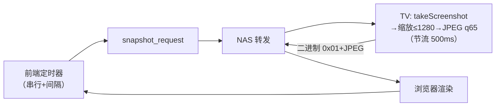

# 低帧率慢刷（Auto Refresh）设计

| 项目 | 内容 |
|------|------|
| 文档版本 | v1.0（待确认） |
| 创建日期 | 2026-11-25 |
| 文档状态 | 草稿 |
| 目标读者 | Web 前端、Android 电视端、测试 |

## 一、背景与目标

- 现状：遥控页只有手动「截屏」，点一次看一张；操作后想知道结果必须再手动点一次，体验割裂。
- 目标：以**可配置的低帧率**自动刷新快照，形成"准实时"画面感知；同时严格控制电视端负担与流量。
- 原则（延续 ADR-0001）：**不做实时流**，快照是唯一画面通道；"慢刷"只是给快照模型加节奏，不引入媒体流。

## 二、方案总览

| 决策点 | 方案 | 理由 |
|---|---|---|
| 刷新驱动 | **前端定时器**：浏览器循环发 `snapshot_request` | 服务端**零改动**；频率由帮助者自选；KISS |
| 请求节奏 | **串行**：收到上一张之后才开始下一张，再叠加固定间隔 | 防请求堆积；慢网自动退避，天然不会风暴 |
| 电视端节流 | 距上次成功截图 **<500ms** 的请求直接忽略 | 兜底防轰炸（多浏览器/前端 bug） |
| 图片瘦身 | 电视端截图**缩放到宽 ≤1280**，JPEG 质量 65 | 4K 真机单帧从 ~2MB 降到 ~50KB，这是真机可用的前提 |
| 服务端 | 不改（现有转发已满足） | YAGNI；多浏览器并发由电视端节流兜底 |

### 数据流



## 三、交互设计（web/src/views/Remote.vue）

工具栏变为：

```
[自动刷新 ⬤/○] [频率: 慢3s | 标准1.5s | 快0.8s] [截屏] [返回][主页][音量±] [断开]
```

- 开启后显示**倒计时进度环**（距下一帧的时间），刷新中图标转圈。
- 频率切换立即生效（重置当前周期）。

### 行为规则

| # | 规则 |
|---|---|
| 1 | 开启自动刷新 → 立即请求第一张 → 收到后等间隔 → 循环（串行） |
| 2 | 点按/滑动/系统键后 → **立即补一张**并重置周期（操作反馈） |
| 3 | 设备离线/发送失败 → 暂停刷新并提示；收到 `device_status online` 后自动继续 |
| 4 | 单次收图超时（>6s）→ 跳过本周期继续；**连续 3 次超时**才暂停并提示 |
| 5 | 离开页面/关闭会话 → 清定时器 + close_session + 关 WS |

## 四、电视端改造

| 项 | 现状 | 改为 | 文件 |
|---|---|---|---|
| 截图尺寸 | 原生分辨率（4K 真机=3840 宽，单帧 ~2MB） | 缩放至宽 **≤1280**（保持比例） | `TvClient.kt` sendSnapshot |
| JPEG 质量 | 70 | **65** | `TvClient.kt` |
| 节流 | 无 | 距上次成功截图 **<500ms** 忽略请求 | `ScreenCaptureService.kt`（记录时间戳） |
| 超时标记 | 无 | `takeScreenshot` onFailure 打日志（带错误码） | `ScreenCaptureService.kt` |

缩放用 `Bitmap.createScaledBitmap`；只缩不放（原图小于 1280 则不缩）。

## 五、Web 通道改造（web/src/ws.js）

- `RemoteSocket` 增加**自动重连**：断开后指数退避 1s→2s→4s…上限 10s；
- 重连成功后自动重新 `open_session`（deviceId 已记忆），并回调通知页面恢复刷新。

## 六、参数表

| 参数 | 值 | 说明 |
|---|---|---|
| 帧间隔（前端） | 3000 / 1500 / 800 ms | 慢 / 标准 / 快 |
| 电视端最小间隔 | 500 ms | 节流上限 ≈2 FPS |
| JPEG 质量 | 65 | |
| 缩放最大宽 | 1280 px | |
| 单帧超时 | 6000 ms | |
| 重连退避 | 1s×2，上限 10s | |

**流量估算**：720p、q65 ≈ 40–60KB/帧；标准档（1.5s）≈ **30KB/s**，慢档 ≈ 15KB/s。NAS 家宽上行毫无压力。

## 七、边界与异常

| 场景 | 行为 |
|---|---|
| 电视离线 | 前端暂停刷新 + 提示「设备离线」；恢复后自动继续 |
| WS 断开 | 前端自动重连，成功后 open_session + 恢复刷新 |
| 连续超时 3 次 | 暂停 + 提示，可手动点「截屏」探测 |
| 多个浏览器同时看 | 都能收到快照；电视端 500ms 节流兜底（后到请求被忽略，各浏览器拿到的是最近一张） |
| 服务端重启 | 电视端 WS 断 → OkHttp 不会自动重连 → **电视端也要加重连**（见下） |

> 补充：电视端 `TvClient` 目前断线不重连。本次一并加上：断开后 3s 重试，直到成功（自用场景固定间隔即可）。

## 八、测试计划

**自动化**（新增 `server/test_refresh.py`，复用 test_ws 的模拟浏览器）：
- 以 1.5s 间隔连收 **10 帧**，统计：成功帧数、平均帧大小、端到端耗时（发请求→收到图）。
- 断言：≥9/10 成功、单帧 <150KB、模拟器上平均耗时 <1.5s。

**手动清单**：
1. 浏览器开「标准」档，电视停桌面 → 画面按周期变化（看状态栏时钟）。
2. 电视打开第三方 App → 刷新后画面跟随变化。
3. 点按画面 → 补帧反映点击效果。
4. 切换频率 → 立即生效。
5. kill 模拟器 → 前端提示离线；重启模拟器 → 自动恢复。
6. 重启 NAS 服务端 → 电视端 3s 内自动重连。
7. `adb logcat` 无异常、电视端 CPU 无异常飙升。

## 九、任务拆分

| # | 任务 | 文件 |
|---|---|---|
| 1 | 电视端：缩放 + 节流 + 失败日志 + 断线重连 | `TvClient.kt`、`ScreenCaptureService.kt` |
| 2 | Web：RemoteSocket 自动重连 | `web/src/ws.js` |
| 3 | Web：自动刷新 UI + 串行定时器 + 操作补帧 + 超时暂停 | `web/src/views/Remote.vue` |
| 4 | 构建（npm build / gradle assembleDebug）+ 重装 | — |
| 5 | 链路压测脚本 | `server/test_refresh.py` |
| 6 | 手动联调（上表 7 项） | — |
